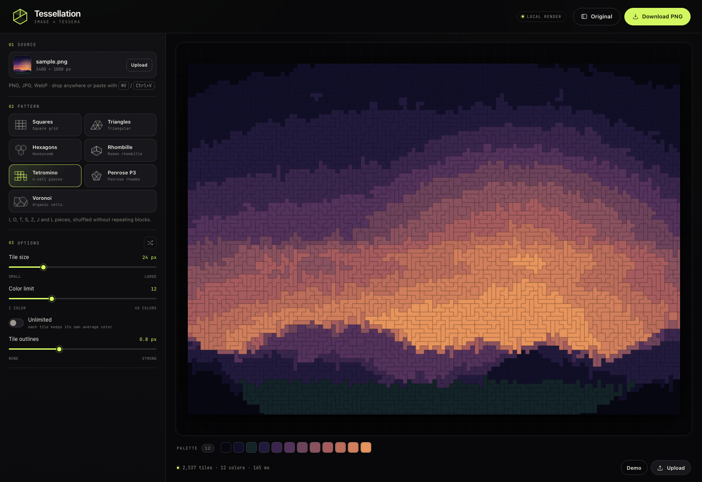

# Tesselation

Превращает изображение в мозаику из однотонных тайлов. Загрузите PNG, JPG или WebP
— приложение разложит картинку на квадраты, треугольники, шестиугольники, ромбы,
тетромино, ромбы Пенроуза или ячейки Вороного и подберёт палитру.

Всё считается в браузере: файл не уходит на сервер.


Тетромино после локальных переклеек — без повторяющихся блоков и видимой сетки:



## Возможности

- **7 типов мозаики**: квадратная сетка, треугольная, соты, ромбилль (Roman
  rhombille), тетромино, Пенроуз P3 и ячейки Вороного.
- **Зернистость** — размер тайлов от 8 до 80 px (относительно рабочей копии
  изображения, которая масштабируется максимум до 1600 px).
- **Лимит цветов** — от 1 до 40 цветов или режим без ограничения, когда каждый
  тайл получает собственный средний цвет.
- **Точный подбор цвета**: средний цвет тайла считается в линейном свете, а
  палитра подбирается k-means в перцептивном пространстве OKLab.
- **Экспорт PNG**, просмотр оригинала одним нажатием, перетаскивание файла,
  вставка из буфера (⌘V / Ctrl+V).
- Адаптивный интерфейс для десктопа и телефона. Демо-изображение загружается
  автоматически при первом открытии.

## Быстрый старт

Нужен Node.js 20.19+.

```bash
npm install
npm run dev
```

Vite покажет адрес локального сервера (по умолчанию `http://127.0.0.1:5173`).

Сборка и проверки:

```bash
npm run build     # tsc --noEmit + vite build
npm run typecheck
npm test          # vitest
```

## GitHub Pages

Да, проект полностью статический. В `vite.config.ts` стоит относительный
`base: './'`, поэтому сборка работает и в корне домена, и в подпапке вида
`https://<user>.github.io/<repo>/`.

Один раз:

1. Запушьте проект в GitHub (workflow лежит в
   [.github/workflows/deploy.yml](.github/workflows/deploy.yml)).
2. В репозитории откройте **Settings → Pages → Build and deployment** и
   выберите **Source: GitHub Actions**.
3. Сделайте push в `master` или `main` (либо запустите workflow вручную через
   **Actions → Deploy to GitHub Pages → Run workflow**).

Workflow сам выполнит `npm ci`, тесты, `npm run build` и опубликует содержимое
`dist/`. Получившийся адрес будет показан в Actions и в настройках Pages.

Локально production-сборку можно проверить так:

```bash
npm run build
npx vite preview
```

## Типы мозаики

| Тип | Описание |
| --- | --- |
| Квадраты | Классическая сетка, самый предсказуемый результат. |
| Треугольники | Плотная сетка из равносторонних треугольников. |
| Соты | Шестиугольники с площадью ячейки ≈ `tileSize²`. |
| Ромбилль | Каждый шестиугольник расколот на три ромба 60°/120°. |
| Тетромино | Случайная упаковка фигур I, O, T, S, Z, J, L из четырёх клеток; без повторяющихся блоков и видимой сетки. |
| Пенроуз P3 | Толстые и тонкие ромбы, построенные как двойственная сетка де Брёйна. |
| Вороной | Органические ячейки из дрожащей сетки seed-точек. |

## Как это работает

1. **Подготовка источника.** Изображение уменьшается так, чтобы большая сторона
   была не больше 1600 px, и рисуется на белом фоне (прозрачность PNG
   композитится с белым).
2. **Генерация тайлов.** Каждая раскладка возвращает набор полигонов, покрывающих
   прямоугольник с запасом. Полигоны обрезаются по границам изображения.
3. **Средний цвет.** Для каждого тайла пиксели внутри полигона усредняются в
   линейном RGB. Это важнее, чем кажется: среднее в sRGB даёт более грязные и
   тёмные края на градиентах.
4. **Квантование палитры.** Средние цвета переводятся в OKLab. При ограничении
   палитры запускается взвешенный по площади k-means++ (до 40 кластеров), после
   чего каждому тайлу назначается ближайший цвет палитры.
5. **Рендер.** Тайлы заливаются своей палитрой на canvas; при желании
   добавляются тонкие контуры, подчёркивающие рисунок раскладки.

## Параметры

- **Зернистость** — целевая площадь тайла. У разных раскладок разная форма, но
  средняя площадь держится около `tileSize²`, поэтому переключение типа мозаики
  не меняет визуальный масштаб картинки радикально.
- **Лимит цветов** — число кластеров k-means. При значении 2 получается
  графичный постер, при 40 — почти фотографическая передача.
- **Без ограничения** — палитра не квантуется; каждый тайл получает свой
  усреднённый цвет.
- **Контуры тайлов** — ширина обводки в пикселях. `0` отключает контуры и даёт
  максимально близкое к исходнику изображение.

## URL-параметры

Настройки можно передать ссылкой — удобно для демонстраций и скриншотов:

```text
/?type=penrose&tile=24&colors=12&seed=20261126&grout=0.8
```

- `type`: `square`, `triangle`, `hexagon`, `rhombille`, `tetromino`, `penrose`,
  `voronoi`;
- `tile`: 8–80;
- `colors`: 1–40 или `0` для режима без ограничения;
- `seed`: целое число для случайных раскладок;
- `grout`: 0–2.4.

## Структура проекта

```text
index.html              разметка интерфейса
src/main.ts             точка входа
src/ui/app.ts           состояние приложения, события, пайплайн рендера
src/ui/icons.ts         SVG-иконки раскладок
src/core/geometry.ts    полигоны, клиппинг, RNG, контуры тетромино
src/core/color.ts       sRGB ↔ linear RGB ↔ OKLab
src/core/analyze.ts     обрезка тайлов и средний цвет по пикселям
src/core/palette.ts     взвешенный k-means++ и назначение цветов
src/core/render.ts      отрисовка мозаики на canvas
src/core/source.ts      загрузка и подготовка изображения
src/tilings/            генераторы всех семи раскладок
tests/                  vitest: покрытие, геометрия, палитра, Пенроуз
docs/preview.png        скриншот для README
legacy-template/        исходный html-template, сохранён без изменений
```

## Тесты

```bash
npm test
```

Тесты проверяют:

- что каждая раскладка покрывает прямоугольник без дырок и наложений;
- что площадь обрезанных тайлов совпадает с площадью изображения;
- геометрию контуров тетромино и отсутствие повторяющейся сетки 8×8;
- отношение толстых и тонких ромбов Пенроуза (≈ φ);
- корректность преобразований sRGB ↔ linear RGB ↔ OKLab;
- что k-means не превышает лимит цветов и стабилен при одном seed.

## Ограничения и заметки

- Рабочая копия ограничена 1600 px по большей стороне — это компромисс между
  качеством и скоростью. Исходное соотношение сторон сохраняется.
- Тетромино собираются за два шага: быстрые точные покрытия блоков 8×8, затем
  тысячи локальных переклеек пар соседних фигур, в том числе через границы
  блоков. Это убирает повторяющийся рисунок и видимую сетку, сохраняя полное
  покрытие без щелей.
- Пенроуз строится через пятисеточный метод де Брёйна; смещения выбираются
  детерминированно от seed, поэтому «Перемешать» меняет патч целиком.
- Прозрачные PNG композитятся на белом фоне: тайл должен иметь непрозрачный
  цвет.
- Внешних runtime-зависимостей нет: только Vite, TypeScript и Vitest для
  разработки.
