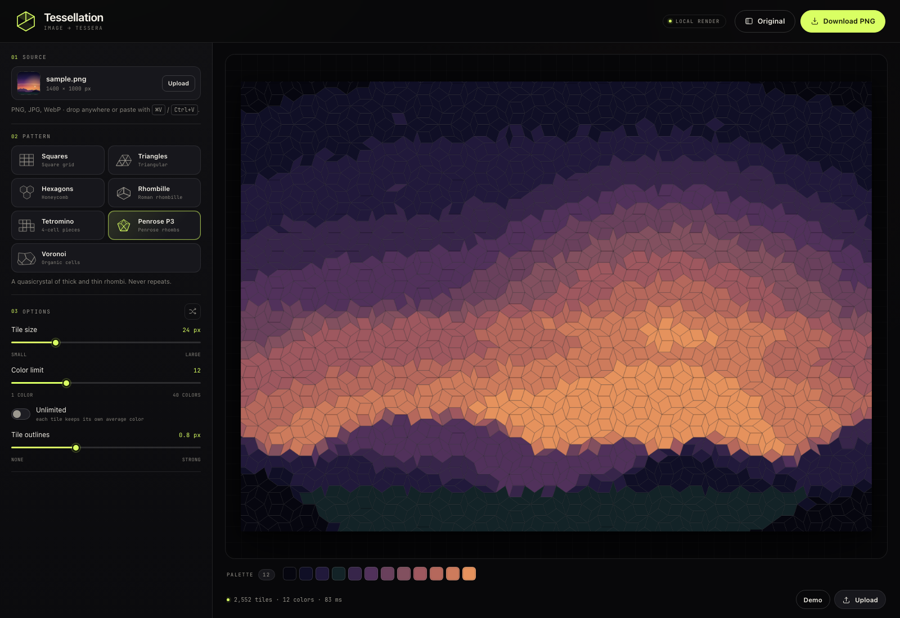

# Tessellation

Turn any image into a mosaic of single-color tiles. Drop in a PNG, JPG, or WebP
and the app will rebuild it from squares, triangles, hexagons, rhombi,
tetrominoes, Penrose rhombs, or Voronoi cells — then pick a palette that keeps
the result as close to the source as possible.

Everything runs in the browser: your image never leaves the device.



Tetrominoes after local pair flips — no repeated blocks and no visible 8×8 grid:


## Features

- **7 tessellation types**: square grid, triangular grid, hexagons, Roman
  rhombille, tetrominoes, Penrose P3, and Voronoi cells.
- **Tile size** from 8 to 80 px, relative to a working copy that is capped at
  1600 px on the long side.
- **Color limit** from 1 to 40 colors, or unlimited mode where every tile keeps
  its own average color.
- **Accurate color matching**: each tile's average is computed in linear light,
  then the palette is chosen with k-means in perceptual OKLab space.
- **PNG export**, one-click comparison with the original, drag and drop, and
  paste from the clipboard (⌘V / Ctrl+V).
- Responsive desktop and mobile UI. A demo image loads automatically on first
  visit.

## Quick start

Requires Node.js 20.19+.

```bash
npm install
npm run dev
```

Vite prints the local server URL (default: `http://127.0.0.1:5173`).

Build and checks:

```bash
npm run build     # tsc --noEmit + vite build
npm run typecheck
npm test          # vitest
```

## GitHub Pages

Yes — the project is fully static. `vite.config.ts` uses a relative `base: './'`,
so the build works both at a domain root and under a project path such as
`https://<user>.github.io/<repo>/`.

One-time setup:

1. Push the project to GitHub. The workflow lives in
   [.github/workflows/deploy.yml](.github/workflows/deploy.yml).
2. In the repository, open **Settings → Pages → Build and deployment** and set
   **Source: GitHub Actions**.
3. Push to `master` or `main`, or run the workflow manually from
   **Actions → Deploy to GitHub Pages → Run workflow**.

The workflow runs `npm ci`, the test suite, `npm run build`, and publishes
`dist/`. The resulting URL is shown in Actions and in the Pages settings.

To check the production build locally:

```bash
npm run build
npx vite preview
```

## Tiling types

| Type | Description |
| --- | --- |
| Squares | The classic, most predictable grid. |
| Triangles | A dense grid of equilateral triangles. |
| Hexagons | Hexagonal cells, like a honeycomb. |
| Rhombille | Roman mosaic: each hexagon is split into three 60°/120° rhombi. |
| Tetromino | Random I, O, T, S, Z, J and L pieces; no repeated blocks or visible grid. |
| Penrose P3 | Thick and thin rhombi built as the dual of a de Bruijn pentagrid. |
| Voronoi | Organic cells generated from a jittered seed grid. |

## How it works

1. **Source preparation.** The image is downscaled so its long side is at most
   1600 px, then drawn on white (PNG transparency is composited onto white).
2. **Tile generation.** Each generator returns polygons that cover the image
   rectangle with some margin. Polygons are clipped to the image bounds.
3. **Average color.** Pixels inside each tile are averaged in linear RGB. This
   matters: averaging in sRGB produces muddier, darker edges on gradients.
4. **Palette quantization.** Tile averages are converted to OKLab. With a color
   limit, an area-weighted k-means++ run (up to 40 clusters) picks the palette,
   and every tile is assigned its nearest palette color.
5. **Render.** Tiles are filled on canvas. Optional thin outlines make the
   tessellation structure visible.

## Controls

- **Tile size** — target tile area. Different patterns have different shapes,
  but their average area stays near `tileSize²`, so switching patterns does not
  radically change the visual scale.
- **Color limit** — the number of k-means clusters. `2` gives a graphic poster
  look; `40` is close to photographic.
- **Unlimited** — skip quantization and give every tile its own average color.
- **Tile outlines** — outline width in pixels. `0` disables outlines and keeps
  the result as close to the source image as possible.

## URL parameters

Settings can be shared as a link — useful for demos and screenshots:

```text
/?type=penrose&tile=24&colors=12&seed=20261126&grout=0.8
```

- `type`: `square`, `triangle`, `hexagon`, `rhombille`, `tetromino`, `penrose`,
  `voronoi`;
- `tile`: 8–80;
- `colors`: 1–40, or `0` for unlimited mode;
- `seed`: integer used by the random patterns;
- `grout`: 0–2.4.

## Project structure

```text
index.html              interface markup
src/main.ts             entry point
src/ui/app.ts           application state, events, render pipeline
src/ui/icons.ts         SVG icons for the tiling cards
src/core/geometry.ts    polygons, clipping, RNG, tetromino outlines
src/core/color.ts       sRGB ↔ linear RGB ↔ OKLab
src/core/analyze.ts     tile clipping and per-pixel average color
src/core/palette.ts     weighted k-means++ and color assignment
src/core/render.ts      canvas mosaic renderer
src/core/source.ts      image loading and source preparation
src/tilings/            generators for all seven tilings
tests/                  vitest: coverage, geometry, palette, Penrose
docs/preview.png        Penrose screenshot for this README
docs/tetromino-preview.png  tetromino screenshot for this README
legacy-template/        original html-template, preserved unchanged
```

## Tests

```bash
npm test
```

The suite currently has 49 tests. It verifies:

- that every tiling covers the rectangle without holes or overlaps;
- that the total area of clipped tiles matches the image area;
- tetromino outline geometry and the absence of a repeating 8×8 grid;
- the thick/thin rhomb ratio in Penrose P3 (≈ φ);
- sRGB ↔ linear RGB ↔ OKLab conversions;
- that k-means respects the color limit and is deterministic for a fixed seed.

## Notes and limitations

- The working copy is capped at 1600 px on the long side — a trade-off between
  quality and speed. The original aspect ratio is preserved.
- Tetrominoes are built in two stages: fast exact covers of 8×8 blocks, then
  thousands of local pair flips, including flips across block borders. This
  removes the repeating pattern and the visible grid while preserving exact
  coverage.
- Penrose P3 uses de Bruijn's pentagrid construction. Offsets are derived
  deterministically from the seed, so **Shuffle** replaces the whole patch.
- Transparent PNGs are composited onto white; every tile needs an opaque color.
- There are no runtime dependencies — only Vite, TypeScript, and Vitest for
  development.
